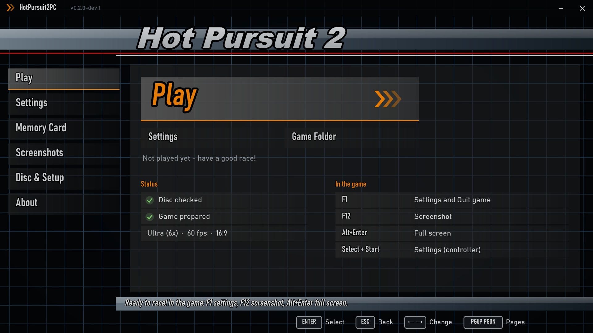

<p align="center">
  
</p>

<p align="center">
  <a href="https://github.com/awtocl/HotPursuit2PC/actions/workflows/ci.yml"></a>
  
  
  <a href="LICENSE"></a>
  
  <a href="#un-mot-sur-lia"></a>
</p>

<p align="center">
  <b>La version PlayStation 2 de <i>Need for Speed: Hot Pursuit 2</i>, en natif sous Windows — construite à partir de votre propre disque.</b>
</p>

<p align="center">
  <a href="https://github.com/awtocl/HotPursuit2PC/releases/latest"><b>Télécharger</b></a> ·
  <a href="docs/GETTING-STARTED.fr.md"><b>Bien démarrer</b></a> ·
  <a href="#démarrage-rapide">Démarrage rapide</a> ·
  <a href="#ce-quil-propose">Ce qu'il propose</a> ·
  <a href="#commandes">Commandes</a> ·
  <a href="#problèmes-connus">Problèmes connus</a> ·
  <a href="#mentions-légales-et-provenance">Mentions légales</a> ·
  <a href="#un-mot-sur-lia">Un mot sur l'IA</a>
</p>

<p align="center">
  🌐 <a href="README.md">English</a> · <a href="README.es.md">Español</a> · <a href="README.pt-BR.md">Português (Brasil)</a> ·
  <b>Français</b> · <a href="README.de.md">Deutsch</a> · <a href="README.it.md">Italiano</a>
</p>

> [!IMPORTANT]
> **Aucun fichier du jeu n'est inclus ni téléchargé.** Il vous faut **votre propre disque** de *Need for Speed: Hot
> Pursuit 2* pour PlayStation 2 (Amérique du Nord, `SLUS-20362`).

> [!NOTE]
> Réalisé avec beaucoup d'aide de l'IA (Claude Code). Curiosité ou scepticisme ? Voici [ce que j'en pense](#un-mot-sur-lia).

---

## Pourquoi ?

> La version PS2 est la meilleure version de ce jeu, alors c'est celle que ce projet amène sur PC.

*Hot Pursuit 2* est sorti sur plusieurs consoles, et c'est la version PS2 dont tout le monde se souvient : la conduite,
les voitures, les circuits, les sensations. Ce n'est pas un remake, ni la version PC de 2003 (assez différente). C'est
exactement ce jeu PS2, transformé en vrai programme Windows : du code x64 natif, la résolution de votre écran, votre
manette — et aucun émulateur entre les deux.

## Ce qu'il propose

| | |
|---|---|
| **Pas d'émulateur** | Le code du jeu lui-même est traduit en code x64 natif (avec LLVM), sur votre PC, à partir de votre copie. Le matériel de la console est remplacé par des équivalents PC : vos fichiers à la place du lecteur, votre carte graphique, un mixeur audio, votre manette. |
| **Graphismes nets** | Direct3D 11 de 1x à 8x la résolution d'origine (suréchantillonné au-delà de celle de votre écran), mise à l'échelle nette, anticrénelage (FXAA), netteté et lignes de balayage en option, plein écran sans bordure. |
| **16:9 et 60 fps** | Écran large d'office (vous voyez plus de route ; le HUD et les menus gardent leur forme) et 60 images par seconde, grâce aux patchs de la communauté pour ce jeu (voir [Crédits](#licence-et-crédits)). Les deux peuvent être désactivés. |
| **Tout le son** | La musique EA Trax, les moteurs et effets, la radio de la police et le son des vidéos. |
| **Un lanceur** | Il trouve votre disque, le copie et le vérifie, prépare le jeu et se souvient de tout ensuite. En plus : des paramètres avec une recommandation pour votre écran, des sauvegardes de la carte mémoire et une galerie de captures (F12). À la souris, au clavier ou à la manette. |
| **Vos commandes, à votre façon** | Une disposition de manette Classique (PS2) et une Moderne (gâchettes), et chaque touche ou bouton peut être réassigné. Retour aux valeurs d'origine en un clic. |
| **Six langues** | Le lanceur et le menu en jeu parlent anglais, espagnol, portugais, français, allemand et italien (la première fois, selon votre Windows). |
| **Paramètres en jeu** | Appuyez sur **F1** (ou Select+Start) pour un menu de paramètres dans le style du jeu, avec *Quitter le jeu*. |
| **Vos fichiers restent à vous** | Votre disque est seulement lu. Tout ce qui en est tiré reste sur votre PC. |

<p align="center"></p>

## Démarrage rapide

**Téléchargez et jouez**, sans outils de compilation :

1. Récupérez **`HotPursuit2PC-v0.2.0-win64.zip`** dans la **[dernière version](https://github.com/awtocl/HotPursuit2PC/releases/latest)** et décompressez-le où vous voulez.
2. Lancez **`HotPursuit2Launcher.exe`**. Les programmes ne sont pas signés, Windows peut donc demander d'abord :
   *Informations complémentaires* → *Exécuter quand même*.
3. Mettez **votre propre disque** dans le lecteur (ou montez votre `.iso`). Le lanceur le copie, le vérifie et traduit
   le jeu **à partir de votre copie, sur votre PC** (environ une minute). Ensuite, appuyez sur **Jouer**.

Les nouveautés de chaque version : [CHANGELOG.md](CHANGELOG.md) (en anglais).

> [!TIP]
> **C'est la première fois que vous faites ce genre de chose ?** Pas de souci : le guide **[Bien démarrer](docs/GETTING-STARTED.fr.md)**
> vous accompagne pas à pas : ce qu'il vous faut, installer les outils, compiler, les meilleurs réglages et quoi faire
> en cas de problème.

**Ou compilez-le vous-même :** sous Windows 10/11 x64 avec *Build Tools for Visual Studio 2022* (charge de travail C++), Git et
PowerShell 7 installés, et **votre propre disque** dans le lecteur (ou votre `.iso` montée) :

```powershell
git clone https://github.com/awtocl/HotPursuit2PC.git
cd HotPursuit2PC
pwsh tools/install-native.ps1       # compile tout, puis ouvre le lanceur
```

La première fois, il compile LLVM (prenez un café : 15 à 40 minutes), puis le projet, et place le lanceur, le jeu et le
recompilateur dans `game-native\`. Le lanceur prend ensuite le relais : il copie et vérifie votre disque et traduit le
jeu **à partir de votre copie, sur votre PC** (environ une minute). Ensuite, lancez simplement
**`HotPursuit2Launcher.exe`**. Environ une heure la première fois ; quelques minutes après une mise à jour.

Le téléchargement ne contient que les programmes de ce projet. Le jeu traduit est toujours fait à partir de votre
propre copie, sur votre propre PC : il n'est jamais distribué.

## Commandes

Choisissez une disposition, ou créez la vôtre :

| Action | Clavier | Manette : Classique (PS2) | Manette : Moderne |
|---|---|---|---|
| Accélérer | Z | A | RT (ou A) |
| Freiner / Marche arrière | A | X | LT |
| Diriger | ← → | Stick gauche / croix | Stick gauche / croix |
| Frein à main | W | RB | B |
| Klaxon / Sirène | X | B | Clic du stick gauche |
| Changer de vue | S | Y | Y |
| Regarder derrière | Q | LB | Clic du stick droit |
| Boost de vitesse | E | Clic du stick droit | X |
| Rapport sup. / Zone Zoom | 2 | RT | RB |
| Rapport inf. / Zone Freeze | 1 | LT | LB |
| Pause | Entrée, Espace | Start | Start |
| Changer de HUD | Retour arrière, Maj droite | Back | Back |

*Classique* reprend la manette PS2 bouton pour bouton ; *Moderne* met l'accélérateur et le frein sur les gâchettes,
comme les jeux de course actuels. Pour changer quoi que ce soit, ouvrez la page **Commandes** du lanceur, choisissez une
case et appuyez sur la touche ou le bouton voulu (deux de chaque par action). **Rétablir le clavier par défaut** et
**Rétablir la manette par défaut** ramènent les dispositions d'origine quand vous voulez, et votre disposition
personnalisée reste enregistrée. La disposition de la manette se change aussi en jeu avec **F1**.

Également pratique : **F1** menu des paramètres, **F12** capture, **Alt+Entrée** ou **F11** plein écran, **Alt+F4** ou
*Quitter le jeu* dans le menu des paramètres pour quitter.

## Problèmes connus

C'est l'une des premières versions, testée sur un seul PC pour l'instant. Voici ce que vous pourriez rencontrer :

- **La sauvegarde n'est pas testée.** Le jeu a une carte mémoire (fichiers dans `game-native\saves`), mais sauvegarder
  et recharger une carrière n'a pas encore été vérifié du début à la fin.
- **Son :** pas encore de réverbération ni de vraies enveloppes de volume, donc certains sons s'arrêtent un peu net.
- **Graphismes :** pas encore de brouillard de profondeur, de mipmaps, de tramage ni de lignes ; le brouillard au loin
  en course est ignoré pour l'instant.
- **Commandes :** pas encore de vibration ni de volant. Le jeu lit l'accélérateur et le frein comme des boutons tout ou
  rien, donc les gâchettes fonctionnent aussi comme des boutons.
- **Langue :** les textes du jeu lui-même restent en anglais (c'est ainsi qu'est livré ce disque nord-américain) ; le
  lanceur et le menu des paramètres suivent votre langue.
- Le passage entre 16:9 et 4:3 ne s'applique qu'après un redémarrage (le jeu place son HUD une seule fois).
- Pas encore essayé avec des cartes AMD ou Intel, sur un Windows tout neuf ni sur de très longues sessions.

Vous avez trouvé autre chose ? [Ouvrez une issue](https://github.com/awtocl/HotPursuit2PC/issues) : ça aide beaucoup.

## Mentions légales et provenance

> [!NOTE]
> Cette traduction est là pour vous faciliter la lecture. La version de référence est l'anglaise :
> [Legal position and provenance](README.md#legal-position-and-provenance).

Lisez cette section avant d'utiliser ou de redistribuer quoi que ce soit.

**Aucune propriété d'Electronic Arts ne se trouve dans ce dépôt.** Chaque fichier source a été écrit pour ce projet et
est publié sous licence MIT (voir [`LICENSE`](LICENSE)). Le dépôt ne contient aucun code, ressource, texte, audio, vidéo
ni autre élément appartenant à Electronic Arts Inc., Sony Interactive Entertainment ou tout autre ayant droit du jeu, ni
aucune partie de l'exécutable du jeu sous quelque forme que ce soit (originale, désassemblée, décompilée ou traduite).

Pour que cela puisse être vérifié, voici tout ce qui, dans le dépôt, a été *tiré* du disque — uniquement des faits sur le
disque, rien de son contenu :

- [`converter/data/slus20362_rom_manifest.tsv`](converter/data/slus20362_rom_manifest.tsv) : noms, tailles et
  empreintes SHA-256 des 27 fichiers du disque, pour distinguer une bonne copie d'une copie endommagée ou différente.
- [`assets-pipeline/data/hp2_slus20362_names.txt`](assets-pipeline/data/hp2_slus20362_names.txt) : les noms de 362
  fichiers dans l'archive du jeu, retrouvés pour que les fichiers extraits aient des noms lisibles.
- [`tests/fixtures/slus20362_zfileset_inventory.tsv`](tests/fixtures/slus20362_zfileset_inventory.tsv) : positions,
  tailles et empreintes SHA-256 de chaque fichier de cette archive, utilisées par les tests.
- [`docs/dump-analysis.md`](docs/dump-analysis.md) : une description du format de ce conteneur et l'inventaire complet
  des fichiers.
- [`docs/recomp-analysis.md`](docs/recomp-analysis.md) et `recomp/tests/test_recomp_dump.cpp` : des mesures du
  programme du jeu (adresses et tailles des sections, nombres d'instructions, de fonctions et de tables de sauts,
  quelques adresses de code). Aucune instruction ni aucun octet du programme lui-même.
- [`recomp/include/hp2/game_patches.h`](recomp/include/hp2/game_patches.h) : les adresses et valeurs des patchs 16:9 et
  60 fps (voir [Crédits](#licence-et-crédits)).

**Vous devez fournir votre propre copie.** Pour utiliser ces outils, il vous faut une copie d'un exemplaire du jeu que
*vous* possédez légalement, faite par vous à partir de votre propre disque. Ce projet ne fournit pas, ne renvoie pas
vers et n'aide pas à trouver des fichiers du jeu, des images disque ou un firmware de console, et ne le fera pas. Aucun
BIOS PlayStation 2 n'est nécessaire ni utilisé. Les lois sur la réalisation et l'usage de copies de sauvegarde de
logiciels que vous possédez varient selon les pays ; il vous appartient de respecter celles qui s'appliquent à vous.

**Comment il a été testé.** Tout le développement et les tests ont été faits avec une seule copie : celle que la
personne qui gère ce dépôt a faite du disque commercial en sa possession. Aucune autre copie du jeu, aucune image téléchargée et
aucun élément de la version Windows n'a été utilisé à aucun moment. Les outils ouvrent la copie en lecture seule et ne
la modifient jamais.

**La traduction se fait sur votre machine.** Tout ce que les outils tirent du jeu — le code recompilé, les ressources
extraites — est produit sur votre propre ordinateur à partir de votre propre copie et y reste. Ne le redistribuez pas.

**Aucune affiliation.** Il s'agit d'un projet indépendant, non commercial, de préservation et d'interopérabilité. Il
n'est ni affilié à, ni sponsorisé, ni approuvé par Electronic Arts, Sony ou les auteurs des logiciels libres sur
lesquels il s'appuie. *Need for Speed* et *Hot Pursuit 2* sont des marques d'Electronic Arts Inc. ; *PlayStation* est une
marque de Sony Interactive Entertainment Inc. Elles ne sont utilisées ici que pour indiquer avec quoi les outils sont
compatibles.

Si vous êtes ayant droit et pensez que quelque chose ici ne devrait pas y être, ouvrez une issue.

## Un mot sur l'IA

> Je sais que beaucoup de gens détestent l'IA, et tôt ou tard tout ce qu'un modèle d'IA a touché, même un peu, finit par
> être traité de « AI slop ». Voici ma position : l'IA ne va pas disparaître. C'est un nouvel outil qui nous permet de
> faire des choses qu'on ne croyait pas possibles avant, et je ne laisserai pas une idéologie m'empêcher de l'intégrer à
> ma façon de travailler. Qu'on l'aime ou qu'on la déteste, l'IA peut écrire du sacrément bon code. Autant s'en servir
> pour se simplifier un peu la vie, découvrir en chemin à quoi elle sert — et, dans mon cas, se lancer dans des projets
> qui ramènent les jeux de mon enfance sur PC.

J'ai lancé HotPursuit2PC pour apprendre concrètement à créer des logiciels avec une IA, sur quelque chose d'assez
difficile pour être un vrai test. Voici comment le travail a été réparti :

- **Un agent de programmation IA a écrit le code, les tests, les scripts et la documentation** — Claude, d'Anthropic,
  dans Claude Code — sous ma direction. Les commits portent une ligne `Co-Authored-By: Claude`.
- **J'ai fixé les objectifs et les règles** (ils sont dans [`docs/brief.md`](docs/brief.md)), fait la copie de mon propre
  disque, approuvé chaque étape qui sortait du projet (comme télécharger du code tiers), testé et joué chaque version et
  pris les décisions — par exemple, abandonner la version avec émulateur pour la recompilation statique après y avoir
  joué.
- **Ce que nous savons du jeu vient de ma propre copie**, par inspection et expériences, avec les preuves consignées dans
  [`docs/dump-analysis.md`](docs/dump-analysis.md). Le code source du jeu n'a jamais été disponible ni utilisé.

Et, pour être honnête avec vous : du code écrit par une IA peut se tromper avec beaucoup d'assurance. Le projet s'appuie
donc sur la méthode plutôt que sur la confiance : chaque affirmation sur le disque est appuyée par une vérification ou un
test, ce qui n'est pas prouvé est marqué **UNVERIFIED** et chaque décision est écrite avec ses alternatives. Personne n'a
relu chaque ligne à la main : jetez-y un œil avant de vous y fier.

## Pour les développeurs

Le fonctionnement interne, la compilation depuis les sources, l'organisation du dépôt et toute la documentation technique
se trouvent dans le [README en anglais](README.md#how-it-works) et dans [`CONTRIBUTING.md`](CONTRIBUTING.md). Les
décisions de conception sont dans [`docs/adr/`](docs/adr/).

## Feuille de route

- [ ] Des sauvegardes fiables (en fichiers PC)
- [ ] Réverbération et vraies enveloppes dans le mixeur audio
- [ ] Brouillard de profondeur et mipmaps dans le rendu GPU
- [ ] Vibration et volants
- [ ] Textes et textures plus nets
- [x] Un téléchargement prêt à jouer, sans outils de compilation
- [ ] Un mouvement plus fluide au-delà de 60 fps

C'est un long chemin, donc pas de dates : ce sera prêt quand ce sera prêt.

## Licence et crédits

Le code et la documentation de ce dépôt sont publiés sous [licence MIT](LICENSE).

- **Patchs du jeu :** les valeurs 16:9 et 60 fps viennent du fichier de patchs de la communauté pour ce disque dans
  [PCSX2/pcsx2_patches](https://github.com/PCSX2/pcsx2_patches) (`SLUS-20362_1D2818AF.pnach`) : *Widescreen 16:9* par
  **nemesis2000**, *HUD fixed for widescreen* par **Aero_** et *60 FPS* par **asasega**. Seules les adresses et les
  valeurs ont été utilisées, réimplémentées comme des patchs activables. Merci !
- **LLVM** (Apache 2.0 avec exceptions LLVM) : le générateur de code du recompilateur.
- **Play!** de Jean-Philip Desjardins (BSD 2-Clause) : le cœur d'émulation du lanceur de référence et ses bibliothèques
  (détails dans [`docs/prior-art.md`](docs/prior-art.md)). Le jeu natif ne contient aucun code tiers ; il utilise
  Direct3D 11, XAudio2 et XInput de Windows.
