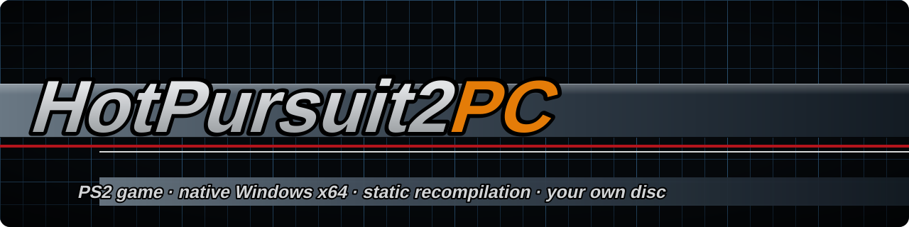

<p align="center">
  
</p>

<p align="center">
  <a href="https://github.com/awtocl/HotPursuit2PC/actions/workflows/ci.yml"></a>
  
  
  <a href="LICENSE"></a>
  
  <a href="#due-parole-sullia"></a>
</p>

<p align="center">
  <b>La versione PlayStation 2 di <i>Need for Speed: Hot Pursuit 2</i>, nativa su Windows — creata dal tuo disco.</b>
</p>

<p align="center">
  <a href="https://github.com/awtocl/HotPursuit2PC/releases/latest"><b>Scarica</b></a> ·
  <a href="docs/GETTING-STARTED.it.md"><b>Per iniziare</b></a> ·
  <a href="#avvio-rapido">Avvio rapido</a> ·
  <a href="#cosa-offre">Cosa offre</a> ·
  <a href="#comandi">Comandi</a> ·
  <a href="#problemi-noti">Problemi noti</a> ·
  <a href="#note-legali-e-provenienza">Note legali</a> ·
  <a href="#due-parole-sullia">Due parole sull'IA</a>
</p>

<p align="center">
  🌐 <a href="README.md">English</a> · <a href="README.es.md">Español</a> · <a href="README.pt-BR.md">Português (Brasil)</a> ·
  <a href="README.fr.md">Français</a> · <a href="README.de.md">Deutsch</a> · <b>Italiano</b>
</p>

> [!IMPORTANT]
> **Nessun file del gioco è incluso né viene scaricato.** Ti serve **il tuo disco** di *Need for Speed: Hot Pursuit 2*
> per PlayStation 2 (Nord America, `SLUS-20362`).

> [!NOTE]
> Fatto con tanto aiuto dell'IA (Claude Code). Curiosità o scetticismo? Ecco [cosa ne penso](#due-parole-sullia).

---

## Perché?

> La versione PS2 è la migliore versione di questo gioco, quindi è quella che questo progetto porta su PC.

*Hot Pursuit 2* è uscito su diverse console, e quella che tutti ricordano è la versione PS2: la guida, le auto, i
tracciati, le sensazioni. Non è un remake, né la versione PC del 2003 (piuttosto diversa). È proprio quel gioco PS2,
trasformato in un vero programma Windows: codice x64 nativo, la risoluzione del tuo monitor, il tuo controller — e nessun
emulatore in mezzo.

## Cosa offre

| | |
|---|---|
| **Niente emulatore** | Il codice del gioco viene tradotto in codice x64 nativo (con LLVM), sul tuo PC e dalla tua copia. L'hardware della console è sostituito da equivalenti PC: i tuoi file al posto del lettore, la tua scheda video, un mixer audio, il tuo controller. |
| **Grafica nitida** | Direct3D 11 da 1x a 8x la risoluzione originale (con supersampling quando supera quella del tuo schermo), scalatura nitida, antialiasing (FXAA), nitidezza e scanline opzionali, schermo intero senza bordi. |
| **16:9 e 60 fps** | Widescreen di serie (vedi più strada; HUD e menu mantengono la forma) e 60 fotogrammi al secondo, grazie alle patch della community per questo gioco (vedi [Crediti](#licenza-e-crediti)). Entrambi disattivabili. |
| **Tutto l'audio** | La musica di EA Trax, motori ed effetti, la radio della polizia e l'audio dei filmati. |
| **Un launcher** | Trova il tuo disco, lo copia e lo verifica, prepara il gioco e poi si ricorda tutto. In più: impostazioni con un consiglio per il tuo schermo, backup della memory card e una galleria di screenshot (F12). Con mouse, tastiera o controller. |
| **I tuoi comandi, a modo tuo** | Una configurazione del controller Classica (PS2) e una Moderna (grilletti), e ogni tasto e pulsante si può riassegnare. Torna ai predefiniti con un clic. |
| **Sei lingue** | Il launcher e il menu in gioco parlano inglese, spagnolo, portoghese, francese, tedesco e italiano (la prima volta, come il tuo Windows). |
| **Impostazioni in gioco** | Premi **F1** (o Select+Start) per un menu di impostazioni nello stile del gioco, con *Esci dal gioco*. |
| **I tuoi file restano tuoi** | Il tuo disco viene solo letto. Tutto ciò che ne deriva resta sul tuo PC. |

<p align="center"></p>

## Avvio rapido

**Scarica e gioca**, senza strumenti di compilazione:

1. Prendi **`HotPursuit2PC-v0.2.0-win64.zip`** dall'**[ultima versione](https://github.com/awtocl/HotPursuit2PC/releases/latest)** ed estrailo dove vuoi.
2. Avvia **`HotPursuit2Launcher.exe`**. I programmi non sono firmati, quindi Windows potrebbe chiedere prima:
   *Ulteriori informazioni* → *Esegui comunque*.
3. Metti **il tuo disco** nel lettore (o monta la tua `.iso`). Il launcher lo copia, lo verifica e traduce il gioco
   **dalla tua copia, sul tuo PC** (circa un minuto). Poi premi **Gioca**.

Cosa è cambiato in ogni versione: [CHANGELOG.md](CHANGELOG.md) (in inglese).

> [!TIP]
> **Prima volta che fai una cosa del genere?** Nessun problema: la guida **[Per iniziare](docs/GETTING-STARTED.it.md)** ti
> accompagna passo passo: cosa ti serve, installare gli strumenti, compilare, le impostazioni migliori e cosa fare se
> qualcosa va storto.

**Oppure compilalo tu:** su Windows 10/11 x64 con *Build Tools for Visual Studio 2022* (carico di lavoro C++), Git e PowerShell 7
installati, e **il tuo disco** nel lettore (o la tua `.iso` montata):

```powershell
git clone https://github.com/awtocl/HotPursuit2PC.git
cd HotPursuit2PC
pwsh tools/install-native.ps1       # compila tutto e poi apre il launcher
```

La prima volta compila LLVM (prenditi un caffè: 15–40 minuti), poi il progetto, e mette launcher, gioco e ricompilatore
in `game-native\`. Da lì ci pensa il launcher: copia e verifica il tuo disco e traduce il gioco **dalla tua copia, sul
tuo PC** (circa un minuto). Dopo, basta avviare **`HotPursuit2Launcher.exe`**. Circa un'ora la prima volta; pochi minuti
dopo un aggiornamento.

Il download contiene solo i programmi di questo progetto. Il gioco tradotto viene sempre creato dalla tua copia, sul
tuo PC: non viene mai distribuito.

## Comandi

Scegli una configurazione o creane una tua:

| Azione | Tastiera | Controller: Classica (PS2) | Controller: Moderna |
|---|---|---|---|
| Accelera | Z | A | RT (o A) |
| Frena / Retromarcia | A | X | LT |
| Sterza | ← → | Levetta sinistra / croce direzionale | Levetta sinistra / croce direzionale |
| Freno a mano | W | RB | B |
| Clacson / Sirena | X | B | Clic levetta sinistra |
| Cambia visuale | S | Y | Y |
| Guarda indietro | Q | LB | Clic levetta destra |
| Boost di velocità | E | Clic levetta destra | X |
| Marcia su / Zone Zoom | 2 | RT | RB |
| Marcia giù / Zone Freeze | 1 | LT | LB |
| Pausa | Invio, Spazio | Start | Start |
| Cambia HUD | Backspace, Maiusc destro | Back | Back |

*Classica* è il controller PS2 tasto per tasto; *Moderna* mette acceleratore e freno sui grilletti, come i giochi di guida
di oggi. Per cambiare qualcosa, apri la pagina **Comandi** del launcher, scegli una casella e premi il tasto o il pulsante
che vuoi (due per azione). **Ripristina tastiera predefinita** e **Ripristina controller predefinito** riportano le
configurazioni originali quando vuoi, e la tua configurazione resta salvata per dopo. La configurazione del controller si
cambia anche in gioco con **F1**.

Utili anche: **F1** menu impostazioni, **F12** screenshot, **Alt+Invio** o **F11** schermo intero, **Alt+F4** o *Esci dal
gioco* nel menu impostazioni per uscire.

## Problemi noti

È una delle prime versioni, provata finora su un solo PC. Ecco cosa potresti trovare:

- **Il salvataggio non è testato.** Il gioco ha una memory card (file in `game-native\saves`), ma salvare e caricare una
  carriera non è ancora stato verificato dall'inizio alla fine.
- **Audio:** ancora senza riverbero e senza vere curve di volume, quindi alcuni suoni si interrompono un po' di colpo.
- **Grafica:** ancora senza nebbia di profondità, mipmap, dithering e linee; la nebbia in lontananza in gara per ora è
  saltata.
- **Comandi:** ancora senza vibrazione e senza volante. Il gioco legge acceleratore e freno come pulsanti acceso/spento,
  quindi anche i grilletti funzionano come pulsanti.
- **Lingua:** i testi del gioco restano in inglese (così è fatto questo disco nordamericano); il launcher e il menu
  impostazioni seguono la tua lingua.
- Il passaggio tra 16:9 e 4:3 vale solo dopo un riavvio (il gioco dispone il suo HUD una volta sola).
- Non ancora provato con schede AMD o Intel, su un Windows appena installato o in sessioni molto lunghe.

Hai trovato altro? [Apri una issue](https://github.com/awtocl/HotPursuit2PC/issues): aiuta molto.

## Note legali e provenienza

> [!NOTE]
> Questa traduzione è per comodità. La versione di riferimento è quella inglese:
> [Legal position and provenance](README.md#legal-position-and-provenance).

Leggi questa sezione prima di usare o ridistribuire qualsiasi cosa.

**In questo repository non c'è alcuna proprietà di Electronic Arts.** Ogni file sorgente è stato scritto per questo
progetto ed è pubblicato con licenza MIT (vedi [`LICENSE`](LICENSE)). Il repository non contiene codice, risorse, testi,
audio, video né altro materiale di proprietà di Electronic Arts Inc., Sony Interactive Entertainment o di altri titolari
dei diritti del gioco, né alcuna parte dell'eseguibile del gioco in alcuna forma (originale, disassemblata,
decompilata o tradotta).

Perché lo si possa verificare, ecco tutto ciò che nel repository è stato *ricavato* dal disco — solo fatti sul disco,
nulla del suo contenuto:

- [`converter/data/slus20362_rom_manifest.tsv`](converter/data/slus20362_rom_manifest.tsv): nomi, dimensioni e hash
  SHA-256 dei 27 file del disco, per distinguere una copia buona da una danneggiata o diversa.
- [`assets-pipeline/data/hp2_slus20362_names.txt`](assets-pipeline/data/hp2_slus20362_names.txt): i nomi di 362 file
  nell'archivio del gioco, recuperati perché i file estratti abbiano nomi leggibili.
- [`tests/fixtures/slus20362_zfileset_inventory.tsv`](tests/fixtures/slus20362_zfileset_inventory.tsv): posizioni,
  dimensioni e hash SHA-256 di ogni file in quell'archivio, usati dai test.
- [`docs/dump-analysis.md`](docs/dump-analysis.md): una descrizione del formato di quel contenitore e l'inventario
  completo dei file.
- [`docs/recomp-analysis.md`](docs/recomp-analysis.md) e `recomp/tests/test_recomp_dump.cpp`: misure del programma del
  gioco (indirizzi e dimensioni delle sezioni, numeri di istruzioni, funzioni e tabelle di salto, alcuni indirizzi di
  codice). Nessuna istruzione né byte del programma stesso.
- [`recomp/include/hp2/game_patches.h`](recomp/include/hp2/game_patches.h): gli indirizzi e i valori delle patch 16:9 e
  60 fps (vedi [Crediti](#licenza-e-crediti)).

**Devi portare la tua copia.** Per usare questi strumenti ti serve una copia di un esemplare del gioco che *tu* possiedi
legalmente, fatta da te dal tuo disco. Questo progetto non fornisce, non collega e non aiuta a trovare file del gioco,
immagini disco o firmware della console, e non lo farà. Non serve né viene usato alcun BIOS PlayStation 2. Le leggi sulla
creazione e l'uso di copie di backup di software che possiedi variano da paese a paese; sei responsabile di rispettare
quelle che ti riguardano.

**Come è stato testato.** Tutto lo sviluppo e i test sono stati fatti con un'unica copia: quella che chi gestisce il
repository ha ricavato dal disco originale in suo possesso. In nessun momento sono state usate altre copie del gioco,
immagini scaricate o materiale della versione Windows. Gli strumenti aprono la copia in sola lettura e non la modificano
mai.

**La traduzione avviene sulla tua macchina.** Tutto ciò che gli strumenti ricavano dal gioco — il codice ricompilato, le
risorse estratte — viene prodotto sul tuo computer dalla tua copia e resta lì. Non ridistribuirlo.

**Nessuna affiliazione.** Questo è un progetto indipendente, non commerciale, di conservazione e interoperabilità. Non è
affiliato, sponsorizzato o approvato da Electronic Arts, Sony o dagli autori del software open source su cui si basa.
*Need for Speed* e *Hot Pursuit 2* sono marchi di Electronic Arts Inc.; *PlayStation* è un marchio di Sony Interactive
Entertainment Inc. Sono usati qui solo per indicare con cosa sono compatibili gli strumenti.

Se sei titolare di diritti e pensi che qualcosa qui non dovrebbe esserci, apri una issue.

## Due parole sull'IA

> So che tanta gente odia l'IA, e prima o poi tutto ciò che è stato toccato anche solo un po' da un modello di IA viene
> bollato come "AI slop". La mia posizione è questa: l'IA non se ne andrà. È un nuovo strumento che ci permette di fare
> cose che prima non credevamo possibili, e non lascerò che un'ideologia mi impedisca di inserirla nel mio modo di
> lavorare. Che la si ami o la si odi, l'IA sa scrivere codice dannatamente buono. Tanto vale usarla per rendersi la vita
> un po' più facile, scoprire strada facendo a cosa serve — e, nel mio caso, buttarsi in progetti che portano i giochi
> della mia infanzia su PC.

Ho iniziato HotPursuit2PC per imparare sul campo a creare software insieme a un'IA, con qualcosa di abbastanza difficile
da essere un vero test. Ecco come è stato diviso il lavoro:

- **Un agente di programmazione IA ha scritto il codice, i test, gli script e la documentazione** — Claude di Anthropic,
  in Claude Code — sotto la mia direzione. I commit riportano una riga `Co-Authored-By: Claude`.
- **Io ho fissato obiettivi e regole** (sono in [`docs/brief.md`](docs/brief.md)), ho fatto la copia del mio disco, ho
  approvato ogni passo che usciva dal progetto (come scaricare codice di terzi), ho provato e giocato ogni versione e ho
  preso le decisioni — per esempio, lasciare la versione con emulatore per la ricompilazione statica dopo averla giocata.
- **Quello che sappiamo del gioco viene dalla mia copia**, per ispezione ed esperimenti, con le prove annotate in
  [`docs/dump-analysis.md`](docs/dump-analysis.md). Il codice sorgente del gioco non è mai stato disponibile né usato.

E, per essere onesti con te: il codice scritto da un'IA può sbagliare con grande sicurezza. Per questo il progetto si
affida al metodo, non alla fiducia: ogni affermazione sul disco è sostenuta da una verifica o da un test, ciò che non è
provato è segnato **UNVERIFIED** e ogni decisione è scritta con le sue alternative. Nessuno ha controllato ogni riga a
mano: dacci un'occhiata prima di fidarti.

## Per gli sviluppatori

Come funziona dentro, come compilare dai sorgenti, la struttura del repository e tutta la documentazione tecnica sono nel
[README in inglese](README.md#how-it-works) e in [`CONTRIBUTING.md`](CONTRIBUTING.md). Le decisioni di progetto sono in
[`docs/adr/`](docs/adr/).

## Tabella di marcia

- [ ] Salvataggi affidabili (come file PC)
- [ ] Riverbero e vere curve di volume nel mixer audio
- [ ] Nebbia di profondità e mipmap nel renderer GPU
- [ ] Vibrazione e volanti
- [ ] Testi e texture più nitidi
- [x] Un download pronto da giocare, senza strumenti di compilazione
- [ ] Movimento più fluido oltre i 60 fps

È una strada lunga, quindi niente date: sarà pronto quando sarà pronto.

## Licenza e crediti

Il codice e la documentazione di questo repository sono pubblicati con [licenza MIT](LICENSE).

- **Patch del gioco:** i valori 16:9 e 60 fps vengono dal file di patch della community per questo disco in
  [PCSX2/pcsx2_patches](https://github.com/PCSX2/pcsx2_patches) (`SLUS-20362_1D2818AF.pnach`): *Widescreen 16:9* di
  **nemesis2000**, *HUD fixed for widescreen* di **Aero_** e *60 FPS* di **asasega**. Sono stati usati solo indirizzi e
  valori, reimplementati come patch attivabili. Grazie!
- **LLVM** (Apache 2.0 con eccezioni LLVM): il generatore di codice del ricompilatore.
- **Play!** di Jean-Philip Desjardins (BSD 2-Clause): il nucleo di emulazione del launcher di riferimento e le sue
  librerie (dettagli in [`docs/prior-art.md`](docs/prior-art.md)). Il gioco nativo non contiene codice di terzi; usa
  Direct3D 11, XAudio2 e XInput di Windows.
