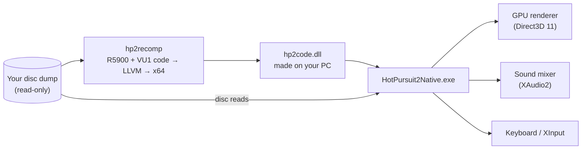

<p align="center">
  
</p>

<p align="center">
  <a href="https://github.com/awtocl/HotPursuit2PC/actions/workflows/ci.yml"></a>
  
  
  <a href="LICENSE"></a>
  
  
</p>

<p align="center">
  <b>The PlayStation 2 version of <i>Need for Speed: Hot Pursuit 2</i>, recompiled to run natively on Windows — built from your own disc.</b>
</p>

<p align="center">
  <a href="#quick-start">Quick start</a> ·
  <a href="#features">Features</a> ·
  <a href="#controls">Controls</a> ·
  <a href="#known-problems">Known problems</a> ·
  <a href="#legal-position-and-provenance">Legal</a> ·
  <a href="#ai-assistance">AI assistance</a> ·
  <a href="docs/STATUS.md">Status</a>
</p>

> [!IMPORTANT]
> **No game files are included, and none are downloaded.** Everything here works only from a dump you made of
> **your own disc** of *Need for Speed: Hot Pursuit 2* for PlayStation 2 (North America, `SLUS-20362`).

> [!NOTE]
> **An AI-assisted project.** I started HotPursuit2PC to get hands-on experience with using AI for software
> development, on a project big enough to be a real test. Almost all of the code, tests and documentation were
> written by an AI coding agent (Anthropic's Claude, in Claude Code) under my direction: I set the goals and the
> rules, made the decisions, tested the builds and played the results. More in [AI assistance](#ai-assistance).

---

## Why

> The best version of this game is the PlayStation 2 one — so that is the version this project brings to the PC.

*Hot Pursuit 2* shipped on several systems, and the PS2 release is the one worth keeping: its handling, its cars, its
tracks and its feel. This is not a remake and not the separate 2003 Windows release. It is that exact PS2 game, made a
first-class Windows program: native x64 code, your monitor's resolution, your controller, your hardware — with no
emulator in the way.

## Features

| | |
|---|---|
| **Native code, no emulator** | The game's own program and its vector-unit microprograms are statically recompiled to x64 (through LLVM) on your PC, from your copy. The console's hardware is replaced by host services: disc reads from your files, a GPU renderer, a sound mixer, XInput. |
| **Modern graphics** | Direct3D 11 renderer with 1x–8x internal resolution (supersampled when above your screen's), sharp-bilinear / bilinear / nearest scaling, optional sharpening and scanlines, borderless full screen. |
| **16:9 and 60 fps** | Widescreen by default (the camera sees more, the HUD keeps its shape, menus keep theirs) and 60 frames per second, through the game's own community patches (see [Credits](#license-and-credits)). Both can be turned off. |
| **Full sound** | EA Trax music, sound effects, police radio and the intro movies' sound, mixed natively. |
| **Movies** | The intro movies fill the screen at their own shape. |
| **In-game settings** | **F1** (or Select+Start) opens a settings menu styled after the game's own, with *Quit game*. |
| **Your files stay yours** | Your dump is only read, never modified. What the tools derive from it stays on your PC. |

## Quick start

**You need:** Windows 10/11 x64 · Visual Studio 2022 (or its Build Tools) with the C++ workload · git · PowerShell 7 · about
3 GB of free disk space for the build tools · and **the contents of your own disc**: a folder holding `SYSTEM.CNF`,
`SLUS_203.62` and `NFSHP2`. If you made an `.iso` of your disc, double-click it to mount it and use its drive, or
extract it with a tool such as 7-Zip.

```powershell
git clone https://github.com/awtocl/HotPursuit2PC.git
cd HotPursuit2PC
pwsh tools/fetch-llvm.ps1           # LLVM source for the recompiler (~171 MB download)
pwsh tools/build-llvm.ps1           # builds it once (~2.5 GB on disk, takes a while)
pwsh tools/install-native.ps1       # asks for your disc folder, builds, recompiles, installs
```

`install-native.ps1` checks the folder and that `SLUS_203.62` is the supported version, builds the project,
recompiles the game's program **from your copy, on your PC**, and writes `game-native\` with
`HotPursuit2Native.exe`, the recompiled code (`hp2code.dll`) and **`Play.cmd`** — double-click that to play. You can
also pass the folder directly: `pwsh tools/install-native.ps1 -Rom "D:\My dumps\Need for Speed - Hot Pursuit 2 (USA)"`.

There are no prebuilt releases: the recompiled code is made from your copy of the game, so it cannot be shipped.

## Controls

An Xbox-style controller works as a DualShock 2. On the keyboard:

| Key | PS2 button | Key | PS2 button |
|---|---|---|---|
| Arrows | D-pad / steering | Enter, Space | Start |
| Z | ✕ | Backspace, Right Shift | Select |
| X | ○ | Q / W | L1 / R1 |
| A | □ | 1 / 2 | L2 / R2 |
| S | △ | F1 | settings menu |

Alt+Enter or F11 toggles full screen; Alt+F4 or *Quit game* in the settings menu quits. Settings are kept in
`hp2native.ini` next to the executable.

## Known problems

This is a development build, tested on one PC so far.

- **No saving yet** — the memory card is not implemented; the game runs as with no card inserted.
- **Sound:** no reverb and no real ADSR envelopes yet, so sounds end more abruptly than on a console.
- **Graphics:** no depth fog, mipmaps, dithering or lines yet; the race's distance fog is skipped.
- **Input:** digital buttons only (no DualShock 2 pressure), no rumble, no steering wheel.
- Switching between 16:9 and 4:3 takes effect after a restart (the game lays its HUD out once).
- Not tested on AMD or Intel graphics, on a clean Windows installation, or in long sessions.

Progress and open questions: [`docs/STATUS.md`](docs/STATUS.md) and [`docs/HANDOVER.md`](docs/HANDOVER.md).

## How it works



- **Recompiler** (`recomp/`): finds the program's 10,146 functions and 193 switch tables without symbols, translates
  the MIPS R5900 code and the vector unit's microprograms through LLVM, and packages them as `hp2code.dll`.
- **Runtime** (`native/`): a minimal kernel (threads, semaphores, timers, interrupts, DMA), the game's I/O-processor
  services answered directly (disc, files, controller, EA's sound streamer), VIF/GIF and a GS implementation — in
  software, and on the GPU.
- **Game patches** (ADR [0015](docs/adr/0015-widescreen.md)): 16:9 and 60 fps are applied by the runtime as patch
  points the recompiler leaves switchable, so they are settings rather than separate builds.

Design decisions are recorded as ADRs in [`docs/adr/`](docs/adr/), each with the options that were rejected.

## Legal position and provenance

Please read this section before using or redistributing anything.

**No Electronic Arts property is in this repository.** Every source file here was written for this project and is
released under the MIT license (see [`LICENSE`](LICENSE)). The repository contains no code, assets, text, audio, video
or other material owned by Electronic Arts Inc., Sony Interactive Entertainment, or any other rights holder of the
game, and no part of the game's executable in any form (original, disassembled, decompiled or translated).

So that this can be checked, here is everything in the repository that was *derived from* the disc — all of it facts
about the disc, none of it content:

| File | What it holds |
|---|---|
| `converter/data/slus20362_rom_manifest.tsv` | names, sizes and SHA-256 hashes of the 27 files on the disc — used to tell a good dump from a damaged or different one |
| `assets-pipeline/data/hp2_slus20362_names.txt` | the names of 362 files inside the game's archive, recovered so that unpacked files get readable names |
| `tests/fixtures/slus20362_zfileset_inventory.tsv` | per-file offsets, sizes and SHA-256 hashes inside that archive, used by the tests |
| `docs/dump-analysis.md` | a description of the archive's container format and the full file inventory |
| `docs/recomp-analysis.md`, `recomp/tests/test_recomp_dump.cpp` | measurements of the game program: section addresses and sizes, counts of instructions, functions and switch tables, a handful of code addresses. No instructions or bytes of the program itself. |
| `recomp/include/hp2/game_patches.h` | the addresses and values of the 16:9 and 60 fps patches (see [Credits](#license-and-credits)) |

**You must bring your own copy.** To use these tools you need a dump of a copy of the game that *you* legally own,
made by you from your own disc. This project does not provide, link to, or help locate game files, disc images or
console firmware, and will not. No PlayStation 2 BIOS is needed or used. The laws on making and using backup copies of
software you own differ between countries; you are responsible for complying with the ones that apply to you.

**How it was tested.** All development and testing was done with a single dump: the one the repository owner made
from the physical retail disc in their possession. No other copy of the game, no downloaded image and no material from
the Windows release was used at any point. The tools open the dump read-only and never modify it.

**Translation happens on your machine.** Everything the tools derive from the game — the recompiled code, unpacked
assets — is produced on your own computer from your own dump and stays there. Do not redistribute it.

**No affiliation.** This is an independent, non-commercial preservation and interoperability project. It is not
affiliated with, sponsored by or endorsed by Electronic Arts, Sony, or the authors of the open-source software it
builds on. *Need for Speed* and *Hot Pursuit 2* are trademarks of Electronic Arts Inc.; *PlayStation* is a trademark
of Sony Interactive Entertainment Inc. They are used here only to say what the tools are compatible with.

If you are a rights holder and believe something here should not be, please open an issue.

## AI assistance

I started this project to learn how to build software together with AI, and to find out how far that can go on
something genuinely hard. Here is exactly how the work was divided:

- **The code, tests, build scripts and documentation were written by an AI coding agent** — Anthropic's Claude,
  running in Claude Code — working at my direction. Commits carry a `Co-Authored-By: Claude` trailer.
- **I set the goals and the hard constraints** (kept in [`docs/brief.md`](docs/brief.md)), supplied the dump of my own
  disc, approved every step that reached outside the project (such as fetching third-party source code), tested the
  builds, played them, and decided the direction — for example, moving from the emulator-backed build to static
  recompilation after playing it.
- **Reverse-engineering findings come from my own dump**, by inspection and experiment, with the evidence for each
  claim recorded in [`docs/dump-analysis.md`](docs/dump-analysis.md). The game's source code was not available and was
  not used. Third-party sources that were consulted are listed with their license status in
  [`docs/prior-art.md`](docs/prior-art.md); the only third-party findings used are the community game patches
  credited below.

What this means for you:

- AI-written code can be wrong in ways that look confident. The project's defence is process rather than trust: every
  claim about the disc is backed by a byte-level check or a test, anything not proven is marked **UNVERIFIED** in the
  docs, decisions are written down as ADRs with the alternatives considered, and each phase ends with a report listing
  what was *not* verified.
- That process has caught real mistakes, and they are left visible on purpose — for example a hash collision that
  briefly gave a file the wrong name, and a performance claim based on per-second averages that hid stutter seen in
  play.
- No human has audited the whole code base line by line. Review it before you rely on it, and treat the numbers in the
  docs as measurements on one PC, not guarantees.

## Building from source

`tools/install-native.ps1` (see [Quick start](#quick-start)) is all a player needs. For development:

```powershell
pwsh tools/build.ps1 -Preset dev                  # build (optimised, with debug info) + run the tests
pwsh tools/build.ps1 -Preset release -NoTest      # release build only
pwsh tools/native-test.ps1 -Until 60 -FastBoot -ShotAt "40"   # scripted run with screenshots (needs a dump in ROM\)
```

The recompiler needs LLVM (`tools/fetch-llvm.ps1` + `tools/build-llvm.ps1`; Apache 2.0 with LLVM Exceptions); without
it everything else builds and the translator and its tests are left out. The reference launcher needs the Play! source
(`tools/fetch-play.ps1`, BSD 2-Clause). Tests that need a real dump look for it in
`ROM\Need for Speed - Hot Pursuit 2 (USA)\` or in the `HP2_ROM_DIR` environment variable, and are skipped otherwise.
Development switches for the native game (`HP2_*` environment variables) are listed in [`CLAUDE.md`](CLAUDE.md) and
the ADRs.

<details>
<summary><b>The reference launcher (emulator-backed)</b> — the project's first milestone, kept for comparison</summary>

Before the native game, the project's first build ran the original PS2 program inside the open-source
[Play!](https://github.com/jpd002/Play-) emulator core, linked into a launcher. It is kept as the *reference* the native
game is checked against; it is not the goal, and its window title says it is emulator-backed.

1. Build it: `pwsh tools/fetch-play.ps1`, then `pwsh tools/build.ps1 -Preset release`.
2. Run `HotPursuit2PC.exe` (or `hp2pc-cli.exe`) from `.cache\build\release\converter\` in an empty folder, select your
   disc folder and choose *portable* or *installed*.
3. Convert. You get a `game\` folder (your verified disc files, the unpacked archive, logs) with
   `game\build\HotPursuit2.exe`, which plays the game: movies, menus, races, pause, and saves on a virtual memory card.

Command line: `hp2pc-cli validate <folder>`, `hp2pc-cli convert --rom <folder>`, `hp2pc-cli status`.

Known problems of this build: stutter on heavy frames (the embedded core), flat tyre smoke and brake-light glow, 4:3
only, races at 30 fps.

</details>

## Repository layout

| Path | Contents |
|---|---|
| [`native/`](native/) | The native game: runtime, kernel and I/O services, GS (software and Direct3D 11), sound mixer, settings menu |
| [`recomp/`](recomp/) | Static recompiler: executable reader, R5900 decoder, function discovery, LLVM translator for the CPU and VU1, packaging |
| [`engine/`](engine/) | The reference launcher and the virtual disc |
| [`converter/`](converter/) | Converter core, CLI and GUI; disc-image builder |
| [`assets-pipeline/`](assets-pipeline/) | Library and tool for the disc's containers (directory, hash, LZC, unpack, inventory) |
| [`tests/`](tests/) | Test harness and fixtures (names, sizes and hashes only) |
| [`tools/`](tools/) | Install, build, test-run and fetch scripts |
| [`docs/`](docs/) | Status, decisions (ADRs), analyses, evidence, phase reports, the original brief |

## Documentation

| Document | What it is |
|---|---|
| [`docs/STATUS.md`](docs/STATUS.md) | Where the project stands, what is next, open questions |
| [`docs/adr/`](docs/adr/) | Architecture decision records, each with the options that were rejected |
| [`docs/recomp-analysis.md`](docs/recomp-analysis.md) | How the game program and its services work, as measured while building the native game |
| [`docs/dump-analysis.md`](docs/dump-analysis.md) | Byte-level findings about the disc and the full file inventory |
| [`docs/prior-art.md`](docs/prior-art.md) | Every third-party source consulted or used, with its license and what was taken |
| [`docs/gate-reports/`](docs/gate-reports/) | End-of-phase reports: verified, not verified, what the owner must decide |
| [`docs/brief.md`](docs/brief.md) | The original project brief and constraints |
| [`CONTRIBUTING.md`](CONTRIBUTING.md) | Rules, workflow, tests, code style |

## Roadmap

Decided in [ADR 0006](docs/adr/0006-recompilation-main-line.md): static recompilation of the game program and its
vector-unit microprograms, host services instead of emulated hardware, a modern renderer, native audio. All four
stages are in the native game today. Next, roughly in order:

- [ ] Memory card saves (as PC save files)
- [ ] Reverb and real envelopes in the sound mixer
- [ ] Depth fog and mipmaps on the GPU renderer
- [ ] DualShock 2 pressure, rumble, steering wheels
- [ ] A friendlier installer than a PowerShell script
- [ ] Motion smoothing above 60 fps

This is a long road and there is no promise of dates.

## Contributing

Read [`CONTRIBUTING.md`](CONTRIBUTING.md) and [`docs/STATUS.md`](docs/STATUS.md) first. Two rules are absolute: never
commit game data (CI rejects it), and never state something about the disc or the game without the evidence for it.

## License and credits

The code and documentation in this repository are released under the [MIT License](LICENSE).

- **Game patches** — the 16:9 and 60 fps values come from the community patch file for this disc in
  [PCSX2/pcsx2_patches](https://github.com/PCSX2/pcsx2_patches) (`SLUS-20362_1D2818AF.pnach`): *Widescreen 16:9* by
  **nemesis2000**, *HUD fixed for widescreen* by **Aero_**, *60 FPS* by **asasega**. Only the addresses and values
  were used, re-implemented as switchable patch points; thank you.
- **LLVM** (Apache 2.0 with LLVM Exceptions) — the recompiler's code generator, built from source by the tools scripts.
- **Play!** by Jean-Philip Desjardins (BSD 2-Clause) — the reference launcher's emulator core, statically linked with
  the libraries it bundles: Play! Framework and CodeGen (BSD 2-Clause), libchdr (BSD 3-Clause), LZMA SDK (public
  domain), Zstandard (BSD), zlib (zlib license), xxHash (BSD 2-Clause), bzip2 (bzip2 license) and GLEW (Modified BSD /
  MIT). Their source is not in this repository; `tools/fetch-play.ps1` downloads pinned revisions at build time, and
  their license texts are written next to the launcher as `THIRD-PARTY-NOTICES.txt`.

Details and revisions: [`docs/prior-art.md`](docs/prior-art.md). The native game itself contains no third-party code;
it uses Windows' own Direct3D 11, XAudio2 and XInput.
