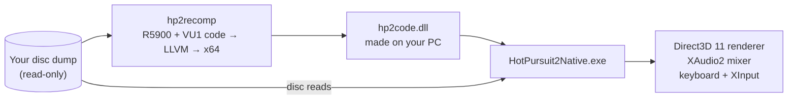

<p align="center">
  
</p>

<p align="center">
  <a href="https://github.com/awtocl/HotPursuit2PC/actions/workflows/ci.yml"></a>
  
  
  <a href="LICENSE"></a>
  
  <a href="#a-word-on-ai"></a>
</p>

<p align="center">
  <b>The PlayStation 2 version of <i>Need for Speed: Hot Pursuit 2</i>, running natively on Windows — built from your own disc.</b>
</p>

<p align="center">
  <a href="https://github.com/awtocl/HotPursuit2PC/releases/latest"><b>Download</b></a> ·
  <a href="docs/GETTING-STARTED.md"><b>Getting started</b></a> ·
  <a href="#quick-start">Quick start</a> ·
  <a href="#features">Features</a> ·
  <a href="#controls">Controls</a> ·
  <a href="#known-problems">Known problems</a> ·
  <a href="#legal-position-and-provenance">Legal</a> ·
  <a href="#a-word-on-ai">A word on AI</a>
</p>

<p align="center">
  🌐 <b>English</b> · <a href="README.es.md">Español</a> · <a href="README.pt-BR.md">Português (Brasil)</a> ·
  <a href="README.fr.md">Français</a> · <a href="README.de.md">Deutsch</a> · <a href="README.it.md">Italiano</a>
</p>

> [!IMPORTANT]
> **No game files are included, and none are downloaded.** You'll need **your own disc** of *Need for Speed: Hot
> Pursuit 2* for PlayStation 2 (North America, `SLUS-20362`).

> [!NOTE]
> Built with a lot of help from AI (Claude Code). Curious, or skeptical? Here's [my take on it](#a-word-on-ai).

---

## Why?

> The PS2 version is the best version of this game, so that's the one this project brings to the PC.

*Hot Pursuit 2* came out on several systems, and the PS2 one is the one people remember: the handling, the cars, the
tracks, the feel. This isn't a remake, and it isn't the (quite different) 2003 PC release. It's that exact PS2 game,
turned into a proper Windows program: native x64 code, your monitor's resolution, your controller — and no emulator in
between.

## Features

| | |
|---|---|
| **No emulator** | The game's own code is translated into native x64 code (with LLVM), right on your PC, from your copy. The console's hardware is replaced with PC equivalents: your files instead of the disc drive, your GPU, a sound mixer, your controller. |
| **Sharp graphics** | Direct3D 11 at 1x–8x the original resolution (supersampled when it's above your screen's), crisp scaling, anti-aliasing (FXAA), optional sharpening and scanlines, borderless full screen. |
| **16:9 and 60 fps** | Widescreen out of the box (you see more of the road, the HUD and menus keep their shape) and 60 frames per second, thanks to the community's patches for this game (see [Credits](#license-and-credits)). Both can be switched off. |
| **All the sound** | EA Trax music, engines and effects, the police radio and the movies' sound. |
| **A launcher** | It finds your disc, copies and checks it, gets the game ready and remembers everything after that. Plus settings with a recommendation for your screen, memory card backups and a screenshot gallery (F12). Works with mouse, keyboard or controller. |
| **Your controls, your way** | A Classic (PS2) and a Modern (triggers) controller layout, and every key and button can be remapped. Restore the defaults with one click. |
| **Six languages** | The launcher and the in-game menu speak English, Spanish, Portuguese, French, German and Italian (picked from Windows the first time). |
| **In-game settings** | Press **F1** (or Select+Start) for a settings menu in the game's own style, including *Quit game*. |
| **Your files stay yours** | Your disc is only ever read. Everything made from it stays on your PC. |

<p align="center"></p>

## Quick start

**Download and play**, no build tools needed:

1. Get **`HotPursuit2PC-v0.2.0-win64.zip`** from the **[latest release](https://github.com/awtocl/HotPursuit2PC/releases/latest)** and unzip it anywhere.
2. Start **`HotPursuit2Launcher.exe`**. The programs aren't signed, so Windows may ask first: *More info* → *Run anyway*.
3. Put **your own disc** in the drive (or mount your `.iso` of it). The launcher copies and checks it and translates the
   game **from your copy, on your PC** (about a minute). Then hit **Play**.

What's new in each version: [CHANGELOG.md](CHANGELOG.md).

> [!TIP]
> **First time doing something like this?** No worries — the **[Getting started](docs/GETTING-STARTED.md)** guide
> walks you through every step: what you need, installing the tools, building, the best settings and what to do if
> something goes wrong.

**Or build it yourself:** on Windows 10/11 x64 with *Build Tools for Visual Studio 2022* (C++ workload), Git and
PowerShell 7 installed, and **your own disc** in the drive (or your `.iso` of it mounted):

```powershell
git clone https://github.com/awtocl/HotPursuit2PC.git
cd HotPursuit2PC
pwsh tools/install-native.ps1       # builds everything, then opens the launcher
```

The first run builds LLVM (grab a coffee: 15–40 minutes), then the project, and puts the launcher, the game and the
recompiler into `game-native\`. The launcher takes it from there: it copies and checks your disc and translates the
game **from your copy, on your PC** (about a minute). After that, just start **`HotPursuit2Launcher.exe`**. Around an
hour the first time; a few minutes after an update.

The download holds only this project's programs. The translated game is always made from your own copy, on your own
PC — it's never shipped.

## Controls

Pick a layout, or make your own:

| Action | Keyboard | Controller: Classic (PS2) | Controller: Modern |
|---|---|---|---|
| Accelerate | Z | A | RT (or A) |
| Brake / Reverse | A | X | LT |
| Steer | ← → | Left stick / D-pad | Left stick / D-pad |
| Handbrake | W | RB | B |
| Horn / Siren | X | B | Left stick click |
| Change view | S | Y | Y |
| Look back | Q | LB | Right stick click |
| Speed boost | E | Right stick click | X |
| Shift up / Zone Zoom | 2 | RT | RB |
| Shift down / Zone Freeze | 1 | LT | LB |
| Pause | Enter, Space | Start | Start |
| Cycle HUD | Backspace, Right Shift | Back | Back |

*Classic* is the PS2 controller button for button; *Modern* puts throttle and brake on the triggers like today's
racing games. To change anything, open the launcher's **Controls** page, pick a box and press the key or button you
want (two of each per action). **Restore Default Keyboard** and **Restore Default Controller** bring the presets back
any time, and your custom layout stays saved for later. The controller layout can also be switched in the game with
**F1**.

Also handy: **F1** settings menu, **F12** screenshot, **Alt+Enter** or **F11** full screen, **Alt+F4** or *Quit game*
in the settings menu to quit.

## Known problems

It's an early release, and it has only been tested on one PC so far. Here's what you might run into:

- **Saving is untested.** The game has a memory card (files in `game-native\saves`), but saving and loading a career
  haven't been checked from start to finish yet.
- **Sound:** no reverb and no proper volume envelopes yet, so some sounds stop a bit abruptly.
- **Graphics:** no depth fog, mipmaps, dithering or lines yet; the distance fog in races is skipped for now.
- **Input:** no rumble and no steering wheel yet. The game reads throttle and brake as on/off buttons, so the triggers
  work like buttons too.
- **Language:** the game's own text stays in English (that's how this North American disc ships); the launcher and the
  settings menu follow your language.
- Switching between 16:9 and 4:3 only kicks in after a restart (the game lays out its HUD once).
- Not tried yet on AMD or Intel graphics, on a fresh Windows install, or in really long sessions.

Found something else? [Open an issue](https://github.com/awtocl/HotPursuit2PC/issues) — it helps a lot. Progress and
open questions live in [`docs/STATUS.md`](docs/STATUS.md).

## How it works



- **The recompiler** (`recomp/`) finds the game program's 10,146 functions and 193 switch tables (no symbols needed),
  translates the PS2's MIPS code and its vector-unit microprograms through LLVM, and packs them into `hp2code.dll`.
- **The runtime** (`native/`) stands in for the console: a small kernel (threads, semaphores, timers, interrupts, DMA),
  the I/O processor's services (disc, files, controller, EA's sound streamer), and the graphics chip — in software and
  on the GPU.
- **Game patches** ([ADR 0015](docs/adr/0015-widescreen.md)): 16:9 and 60 fps are switchable patch points, so they're
  settings rather than separate builds.
- **The launcher** (`launcher/`, [ADR 0016](docs/adr/0016-launcher.md)) checks your disc against the known file
  hashes, runs the recompiler, keeps the game in step with updates and starts it.

Every design decision is written down as an ADR in [`docs/adr/`](docs/adr/), together with the options that didn't make
the cut.

## Legal position and provenance

Please read this section before using or redistributing anything.

**No Electronic Arts property is in this repository.** Every source file here was written for this project and is
released under the MIT license (see [`LICENSE`](LICENSE)). The repository contains no code, assets, text, audio, video
or other material owned by Electronic Arts Inc., Sony Interactive Entertainment, or any other rights holder of the
game, and no part of the game's executable in any form (original, disassembled, decompiled or translated).

So that this can be checked, here is everything in the repository that was *derived from* the disc — all of it facts
about the disc, none of it content:

- [`converter/data/slus20362_rom_manifest.tsv`](converter/data/slus20362_rom_manifest.tsv) — names, sizes and
  SHA-256 hashes of the 27 files on the disc, used to tell a good dump from a damaged or different one.
- [`assets-pipeline/data/hp2_slus20362_names.txt`](assets-pipeline/data/hp2_slus20362_names.txt) — the names of 362
  files inside the game's archive, recovered so that unpacked files get readable names.
- [`tests/fixtures/slus20362_zfileset_inventory.tsv`](tests/fixtures/slus20362_zfileset_inventory.tsv) — per-file
  offsets, sizes and SHA-256 hashes inside that archive, used by the tests.
- [`docs/dump-analysis.md`](docs/dump-analysis.md) — a description of the archive's container format and the full
  file inventory.
- [`docs/recomp-analysis.md`](docs/recomp-analysis.md) and `recomp/tests/test_recomp_dump.cpp` — measurements of the
  game program: section addresses and sizes, counts of instructions, functions and switch tables, a handful of code
  addresses. No instructions or bytes of the program itself.
- [`recomp/include/hp2/game_patches.h`](recomp/include/hp2/game_patches.h) — the addresses and values of the 16:9 and
  60 fps patches (see [Credits](#license-and-credits)).

**You must bring your own copy.** To use these tools you need a dump of a copy of the game that *you* legally own,
made by you from your own disc. This project does not provide, link to, or help locate game files, disc images or
console firmware, and will not. No PlayStation 2 BIOS is needed or used. The laws on making and using backup copies of
software you own differ between countries; you are responsible for complying with the ones that apply to you.

**How it was tested.** All development and testing was done with a single dump: the one the repository owner made
from the physical retail disc in their possession. No other copy of the game, no downloaded image and no material from
the Windows release was used at any point. The tools open the dump read-only and never modify it.

**Translation happens on your machine.** Everything the tools derive from the game — the recompiled code, unpacked
assets — is produced on your own computer from your own dump and stays there. Do not redistribute it.

**No affiliation.** This is an independent, non-commercial preservation and interoperability project. It is not
affiliated with, sponsored by or endorsed by Electronic Arts, Sony, or the authors of the open-source software it
builds on. *Need for Speed* and *Hot Pursuit 2* are trademarks of Electronic Arts Inc.; *PlayStation* is a trademark
of Sony Interactive Entertainment Inc. They are used here only to say what the tools are compatible with.

If you are a rights holder and believe something here should not be, please open an issue.

## A word on AI

> I know a lot of people hate AI, and sooner or later anything that's even slightly touched by an AI model gets called
> "AI slop". Here's where I stand: AI isn't going away. It's a new tool that lets us do things we didn't think were
> possible before, and I'm not going to let an ideology stop me from making it part of my workflow. Love it or hate it,
> AI can write some pretty damn good code. You might as well use it to make your life a little easier, learn what it's
> good for along the way — and, in my case, dive into projects that bring the games of my childhood to the PC.

I started HotPursuit2PC to get hands-on with building software together with AI, on something hard enough to be a real
test. Here's how the work was split:

- **An AI coding agent wrote the code, tests, build scripts and docs** — Anthropic's Claude, in Claude Code — working
  under my direction. Commits carry a `Co-Authored-By: Claude` line.
- **I set the goals and the ground rules** (they're in [`docs/brief.md`](docs/brief.md)), dumped my own disc, approved
  every step that reached outside the project (like fetching third-party source code), tested and played every build,
  and called the shots — for example, dropping the emulator-based build for static recompilation after playing it.
- **What we know about the game comes from my own dump**, by inspection and experiment, with the evidence written down
  in [`docs/dump-analysis.md`](docs/dump-analysis.md). The game's source code was never available or used. Third-party
  sources we looked at are listed with their licenses in [`docs/prior-art.md`](docs/prior-art.md); the only outside
  findings used are the community game patches credited below.

And, to be fair to you:

- AI-written code can be confidently wrong. So the project leans on process, not trust: every claim about the disc is
  backed by a byte-level check or a test, anything unproven is marked **UNVERIFIED**, decisions are written down with
  the alternatives, and each phase ends with a list of what was *not* verified.
- That process has caught real mistakes, and they're left visible on purpose — like a hash collision that briefly gave
  a file the wrong name, or a performance number based on averages that hid stutter you could see while playing.
- Nobody has audited every line by hand. Have a look before you rely on it, and treat the numbers in the docs as
  measurements on one PC, not promises.

## Building from source

The download (see [Quick start](#quick-start)) or `tools/install-native.ps1` is all you need to play. If you want to hack
on it:

```powershell
pwsh tools/build.ps1 -Preset dev                  # build (optimised, with debug info) + run the tests
pwsh tools/build.ps1 -Preset release -NoTest      # release build only
pwsh tools/native-test.ps1 -Until 60 -FastBoot -ShotAt "40"   # scripted run with screenshots (needs a dump in ROM\)
pwsh tools/package-release.ps1 -Version 0.2.0     # the download: programs, licenses, changelog (no game files)
```

The recompiler needs LLVM (`tools/fetch-llvm.ps1` + `tools/build-llvm.ps1`; Apache 2.0 with LLVM Exceptions); without
it everything else still builds and the translator and its tests are skipped. The reference launcher needs the Play!
source (`tools/fetch-play.ps1`, BSD 2-Clause). Tests that need a real dump look for it in
`ROM\Need for Speed - Hot Pursuit 2 (USA)\` or in the `HP2_ROM_DIR` environment variable, and are skipped otherwise.
Debugging switches for the native game are listed in [`CONTRIBUTING.md`](CONTRIBUTING.md#development-switches).

<details>
<summary><b>The reference launcher (emulator-based)</b> — where the project started, kept for comparison</summary>

Before the native game existed, the project's first build ran the original PS2 program inside the open-source
[Play!](https://github.com/jpd002/Play-) emulator core. It's kept as the *reference* the native game is checked
against — not the goal — and its window title says it's emulator-based.

1. Build it: `pwsh tools/fetch-play.ps1`, then `pwsh tools/build.ps1 -Preset release`.
2. Run `HotPursuit2PC.exe` (or `hp2pc-cli.exe`) from `.cache\build\release\converter\` in an empty folder, select your
   disc folder and choose *portable* or *installed*.
3. Convert. You get a `game\` folder (your verified disc files, the unpacked archive, logs) with
   `game\build\HotPursuit2.exe`, which plays the game: movies, menus, races, pause, and saves on a virtual memory card.

Command line: `hp2pc-cli validate <folder>`, `hp2pc-cli convert --rom <folder>`, `hp2pc-cli status`.

Known problems of this build: stutter on heavy frames (the embedded core), flat tyre smoke and brake-light glow, 4:3
only, races at 30 fps.

</details>

## What's where

| Path | Contents |
|---|---|
| [`native/`](native/) | The native game: runtime, kernel and I/O services, graphics (software and Direct3D 11), sound mixer, settings menu |
| [`launcher/`](launcher/) | The launcher: first-run setup from your disc, Play, settings, memory card backups, screenshots |
| [`recomp/`](recomp/) | The static recompiler: program reader, R5900 decoder, function discovery, LLVM translator for the CPU and VU1, packaging |
| [`engine/`](engine/) | The reference launcher and the virtual disc |
| [`converter/`](converter/) | Converter core, CLI and GUI; disc-image builder |
| [`assets-pipeline/`](assets-pipeline/) | Library and tool for the disc's containers (directory, hash, LZC, unpack, inventory) |
| [`tests/`](tests/) | Test harness and fixtures (names, sizes and hashes only) |
| [`tools/`](tools/) | Install, build, test-run and fetch scripts |
| [`docs/`](docs/) | Status, decisions (ADRs), analyses, evidence, phase reports, the original brief |

## Documentation

| Document | What it is |
|---|---|
| [`docs/GETTING-STARTED.md`](docs/GETTING-STARTED.md) | Step by step from your disc to playing, recommended settings, troubleshooting |
| [`CHANGELOG.md`](CHANGELOG.md) | What changed in each version |
| [`docs/STATUS.md`](docs/STATUS.md) | Where the project stands, what's next, open questions |
| [`docs/adr/`](docs/adr/) | Design decisions, each with the options that were turned down |
| [`docs/recomp-analysis.md`](docs/recomp-analysis.md) | How the game program and its services work, as measured while building the native game |
| [`docs/dump-analysis.md`](docs/dump-analysis.md) | Byte-level findings about the disc and the full file inventory |
| [`docs/prior-art.md`](docs/prior-art.md) | Every third-party source looked at or used, with its license and what was taken |
| [`docs/gate-reports/`](docs/gate-reports/) | End-of-phase reports: verified, not verified, what had to be decided |
| [`docs/brief.md`](docs/brief.md) | The original project brief and its ground rules |
| [`CONTRIBUTING.md`](CONTRIBUTING.md) | Rules, workflow, tests, code style, debugging switches |

## Roadmap

The big plan ([ADR 0006](docs/adr/0006-recompilation-main-line.md)) was static recompilation of the game and its
vector-unit microprograms, PC services instead of emulated hardware, a modern renderer and native audio. All four are
in the native game today. What's next, roughly in this order:

- [ ] Memory card saves you can count on (as PC save files)
- [ ] Reverb and proper envelopes in the sound mixer
- [ ] Depth fog and mipmaps on the GPU renderer
- [ ] Pressure-sensitive buttons, rumble, steering wheels
- [ ] Sharper text and textures
- [x] A ready-to-run download, so you don't need the build tools
- [ ] Motion smoothing above 60 fps

It's a long road, so no dates — it's done when it's done.

## Contributing

Help is very welcome! Have a look at [`CONTRIBUTING.md`](CONTRIBUTING.md) and [`docs/STATUS.md`](docs/STATUS.md)
first. Two rules are non-negotiable: never commit game data (CI will reject it), and never claim something about the
disc or the game without the evidence to back it up.

## License and credits

The code and documentation in this repository are released under the [MIT License](LICENSE).

- **Game patches** — the 16:9 and 60 fps values come from the community patch file for this disc in
  [PCSX2/pcsx2_patches](https://github.com/PCSX2/pcsx2_patches) (`SLUS-20362_1D2818AF.pnach`): *Widescreen 16:9* by
  **nemesis2000**, *HUD fixed for widescreen* by **Aero_**, *60 FPS* by **asasega**. Only the addresses and values
  were used, re-implemented as switchable patch points. Thank you!
- **LLVM** (Apache 2.0 with LLVM Exceptions) — the recompiler's code generator, built from source by the tools scripts.
- **Play!** by Jean-Philip Desjardins (BSD 2-Clause) — the reference launcher's emulator core, statically linked with
  the libraries it bundles: Play! Framework and CodeGen (BSD 2-Clause), libchdr (BSD 3-Clause), LZMA SDK (public
  domain), Zstandard (BSD), zlib (zlib license), xxHash (BSD 2-Clause), bzip2 (bzip2 license) and GLEW (Modified BSD /
  MIT). Their source is not in this repository; `tools/fetch-play.ps1` downloads pinned revisions at build time, and
  their license texts are written next to the launcher as `THIRD-PARTY-NOTICES.txt`.

Details and revisions: [`docs/prior-art.md`](docs/prior-art.md). The native game itself contains no third-party code;
it uses Windows' own Direct3D 11, XAudio2 and XInput.
